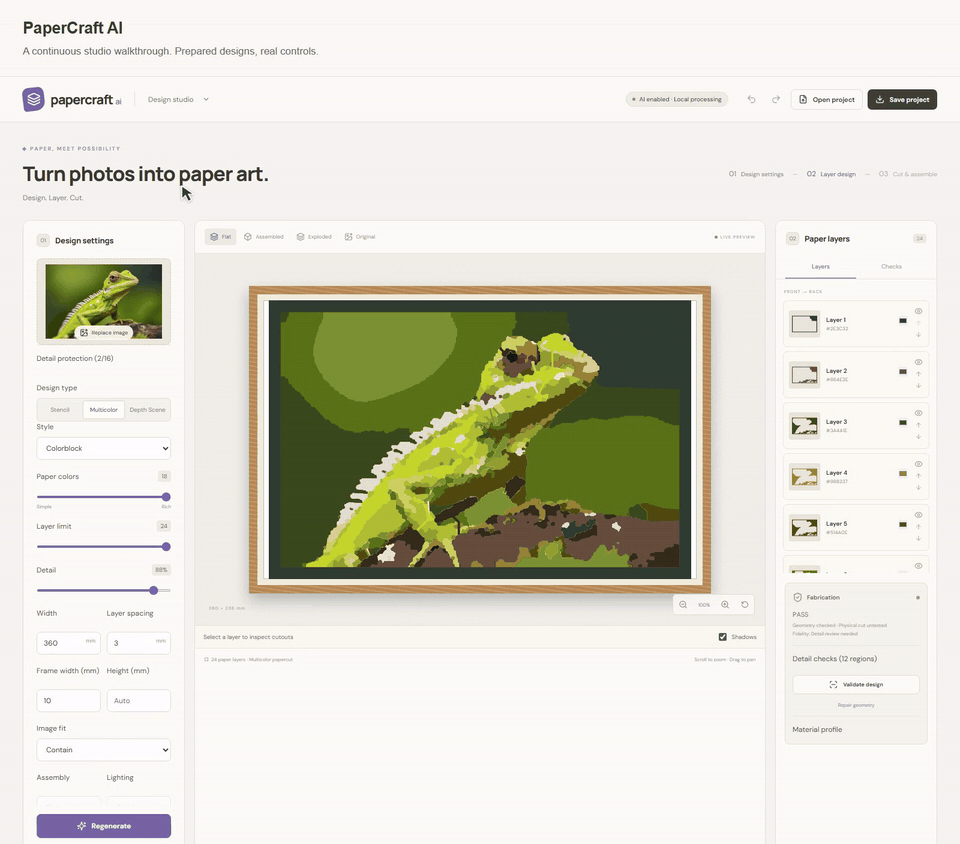
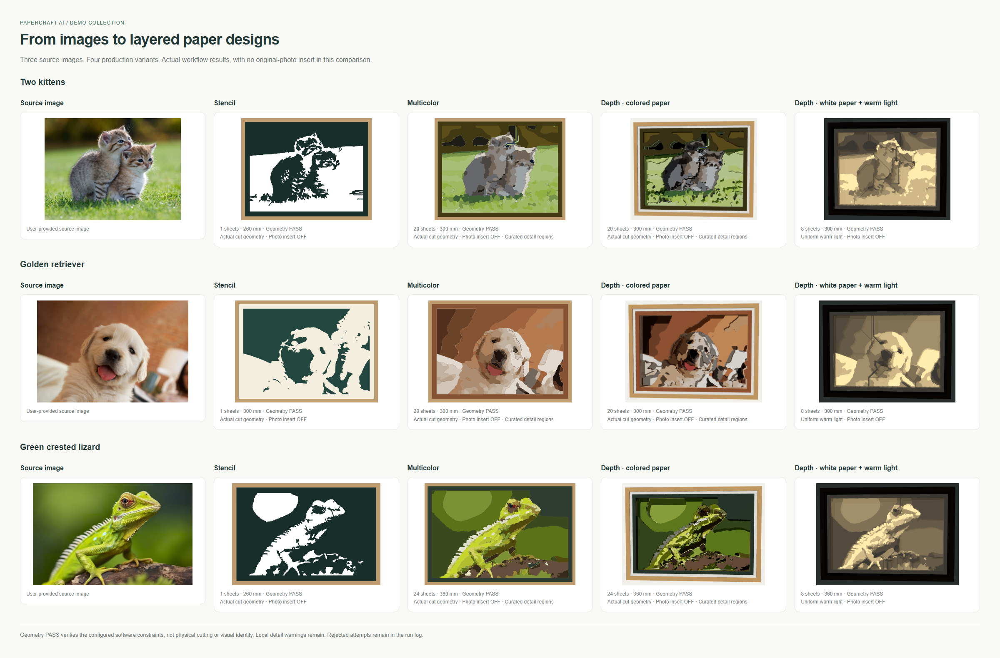
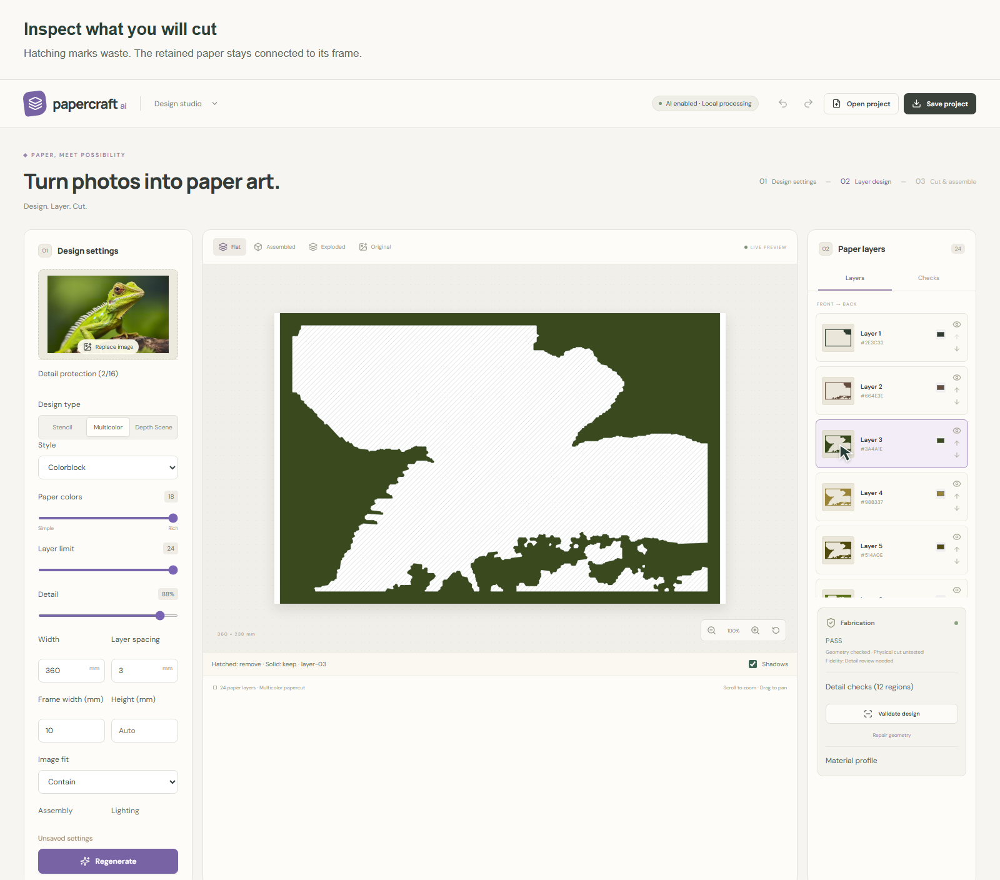
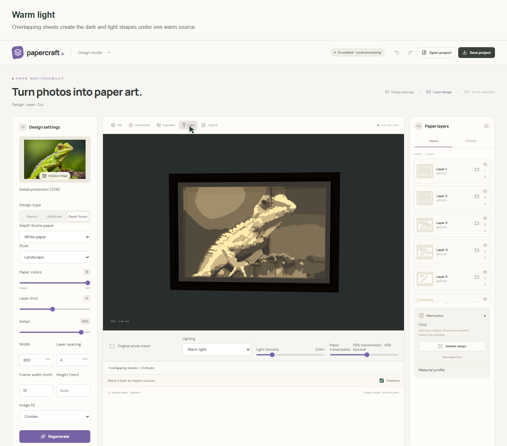
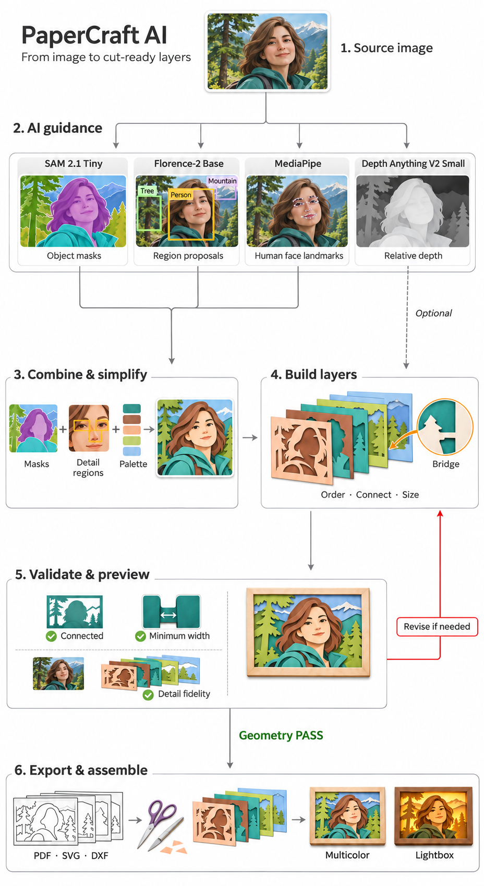

<div align="center">

# PaperCraft AI

**Turn photos into layered paper art.**

Create papercut templates, colored paper compositions and layered lightboxes from your images.

[Getting started](#getting-started) ? [Design modes](#design-modes) ? [Workflow](#how-it-works) ? [Demo gallery](demo-assets/README.md)



[Watch the full demo](demo-assets/animation/studio-tour.mp4)

<sub>Demo uses prepared results with generation waits omitted.</sub>

</div>

Choose a paper style, set the finished size, protect important details and inspect the individual sheets. Preview the assembled artwork before exporting templates to print and cut.

## Design modes

| Mode | Result |
| --- | --- |
| **Stencil** | A connected cut sheet placed over a contrasting backing. |
| **Multicolor** | Colored paper sheets stacked to form the image. |
| **Depth Scene ? Colored paper** | Colored sheets separated by spacers for depth and shadows. |
| **Depth Scene ? White paper** | White sheets that create light and dark shapes through overlapping paper and backlighting. |



## Getting started

From the repository folder:

```sh
uv sync --frozen
cd frontend
npm ci
npm run build
cd ..
uv run papercraft-ai serve
```

Open [the design studio](http://127.0.0.1:8000).

## Create a design

1. **Upload an image.** The initial design starts automatically.
2. **Choose a mode.** Select Stencil, Multicolor or Depth Scene. For Depth Scene, choose white or colored paper.
3. **Adjust the design.** Set the finished width, color count, layer limit, detail level and frame width. Use detail protection to mark regions you want to preserve.
4. **Generate.** After changing design settings, select **Regenerate**. Adjust the processing time limit if needed.
5. **Review.** Inspect the sheets, assembled result and fabrication checks before exporting.

### Inspect the layers

Use **Flat** to review the composition, **Assembled** to see the stack and **Exploded** to inspect layer spacing. Switch to **Original** to compare with the source image. Select an individual layer to inspect its cutouts.



Retained shapes must connect to the surrounding frame. Check recognizable details as well as the fabrication report: **Geometry PASS** confirms the software's geometry checks, not image likeness or a physical cutting trial.

### Preview the lighting

In **Light** view, choose:

- **Warm light** ? the default yellow light.
- **Colored light** ? broad color zones derived from the image.
- **Custom light** ? a uniform color of your choice.

Adjust light intensity and paper transmission to explore the result. **Original photo insert** adds a separate image layer above the light source; turn it off to judge the paper layers alone. Lighting previews are approximate.



## Export, cut and assemble

Select **Download cut-ready** after the current design passes validation. Revalidate after editing the design.

| Format | Use |
| --- | --- |
| **PDF** | Actual-size templates for printing. |
| **SVG / DXF** | Cut paths for vector editing or cutting workflows. |
| **ZIP** | Cut sheets, report and assembly instructions. |
| **Project JSON** | Save a design and reopen it later. |

1. Print at **100% / Actual Size**, disable fit-to-page and check the 20 mm ruler.
2. Remove the **diagonally hatched regions**. Cut along the solid contours; hatch lines only identify waste.
3. Keep the unhatched paper, including the frame and connecting supports.
4. Assemble from back to front. Layer 0 is the front layer; add spacers for Depth Scene designs.

## How it works



AI guidance helps identify regions, important details and relative depth. The design pipeline simplifies the image into paper shapes, orders the sheets, connects retained regions to their frames and checks the resulting cut geometry.

## Tips for better results

- Choose images with a clear subject and distinct shapes.
- Protect small details that define the subject before generating.
- Increase the finished size when important features would be too small to cut.
- If a design fails validation, simplify the details, increase its size or adjust the material profile, then regenerate.
- Review the image without the photo insert before committing to a cut. Fine textures and small features may be simplified.

More examples and annotated guides are available in the [demo gallery](demo-assets/README.md).
