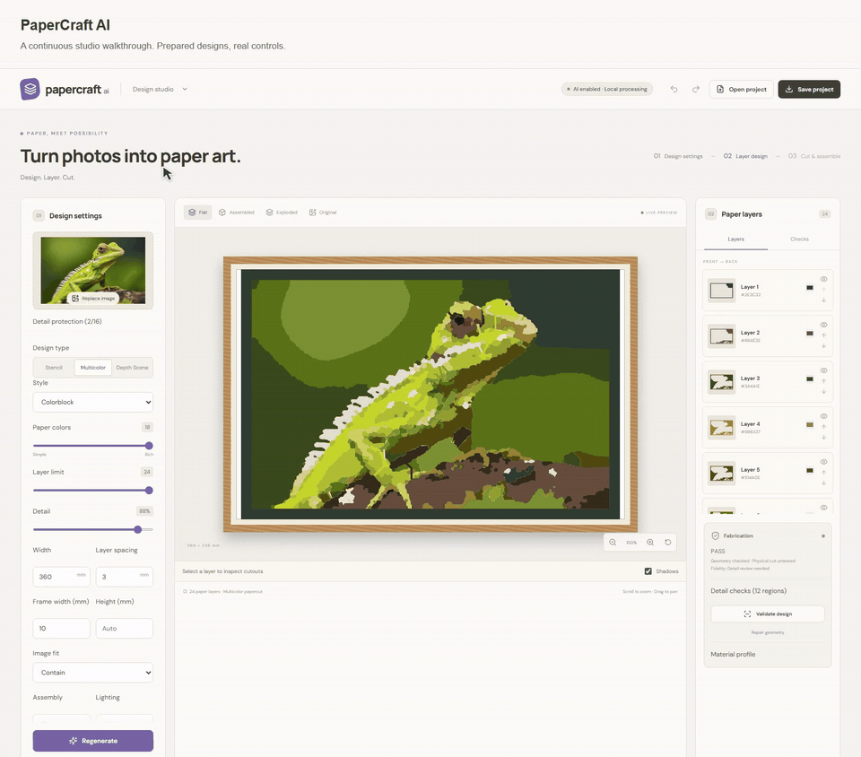
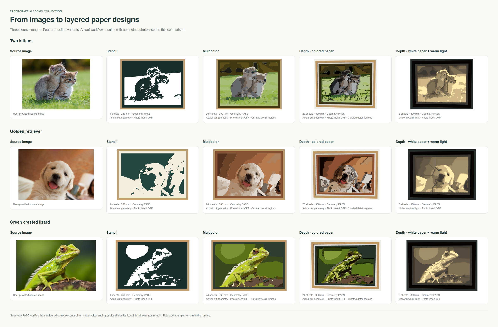
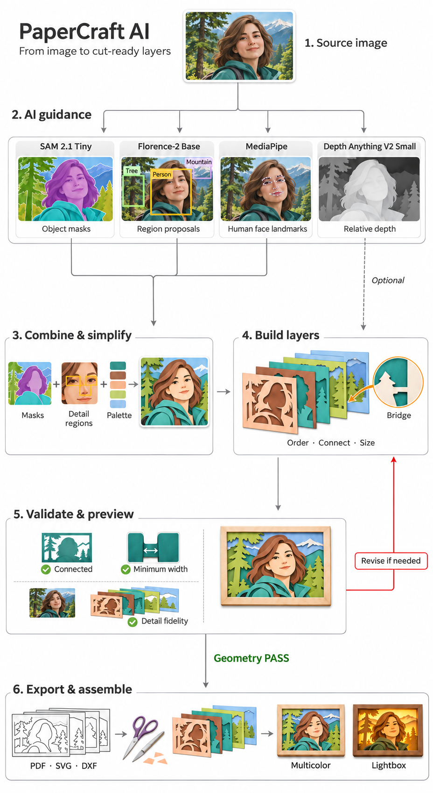

# PaperCraft AI demos

Explore paper-art designs made from three photographs, compare the modes and follow the studio walkthrough.

[Project guide](../README.md) ? [Watch the demo](animation/studio-tour.mp4) ? [Compare all modes](gallery/all-modes.png)

## Studio walkthrough

The demo follows **Multicolor**, **Depth Scene with colored paper**, then **white paper and lighting**. It also shows detail protection, individual cut sheets, layer spacing and the optional photo insert.

Prepared results are shown with generation waits omitted. [Watch the MP4](animation/studio-tour.mp4) for full-quality playback.

## Compare the designs

Each comparison includes the original image and four outputs:

| Mode | What to look for |
| --- | --- |
| **Stencil** | A connected cut sheet over a contrasting backing. |
| **Multicolor** | Colored sheets that form the image when stacked. |
| **Depth Scene ? Colored paper** | Spaced layers with visible depth and shadows. |
| **Depth Scene ? White paper** | Light and dark shapes formed by overlapping paper and backlighting. |

The main comparisons have the original-photo insert turned off so you can judge the paper layers themselves.

| Example | Comparison | Saved designs |
| --- | --- | --- |
| **Kittens** | [View image](gallery/kittens.png) | [Open folder](results/kittens/) |
| **Puppy** | [View image](gallery/puppy.png) | [Open folder](results/puppy/) |
| **Lizard** | [View image](gallery/lizard.png) | [Open folder](results/lizard/) |

## Follow the controls

| Step | Guide |
| --- | --- |
| 1. Choose a mode and size | [Design settings](ui/01-design-settings-annotated.png) |
| 2. Preserve important regions | [Detail protection](ui/02-detail-regions-annotated.png) |
| 3. Review the checks | [Validation](ui/03-validation-annotated.png) |
| 4. Inspect what to remove | [Single-sheet cutouts](ui/04-cut-waste-annotated.png) |
| 5. Preview the stack | [Assembled view](ui/05-assembled-annotated.png) |
| 6. Inspect layer spacing | [Exploded view](ui/06-exploded-annotated.png) |
| 7. Adjust the light | [Lighting controls](ui/07-light-controls-annotated.png) |
| 8. Try the image backing | [Original photo insert](ui/08-photo-insert-annotated.png) |
| 9. Download templates | [Export](ui/09-export-annotated.png) |

## Open a saved example

1. Choose an example in [results](results/), then a mode: `stencil`, `multicolor`, `depth-color` or `depth-white`.
2. In the studio, select **Open project** and choose that folder's `project.json`.
3. Inspect the layers, switch preview views or adjust the lighting.
4. Use `cut-ready.zip` for the saved cutting templates and assembly instructions.

Print templates at **100% / Actual Size**. Diagonal hatching identifies material to remove; keep the unhatched paper and its connecting frame.

All twelve saved designs passed the software geometry checks. Fine details may still be simplified; review the appearance and test the material before cutting a full set.

## Workflow

For setup and the full design instructions, see the [project README](../README.md).
